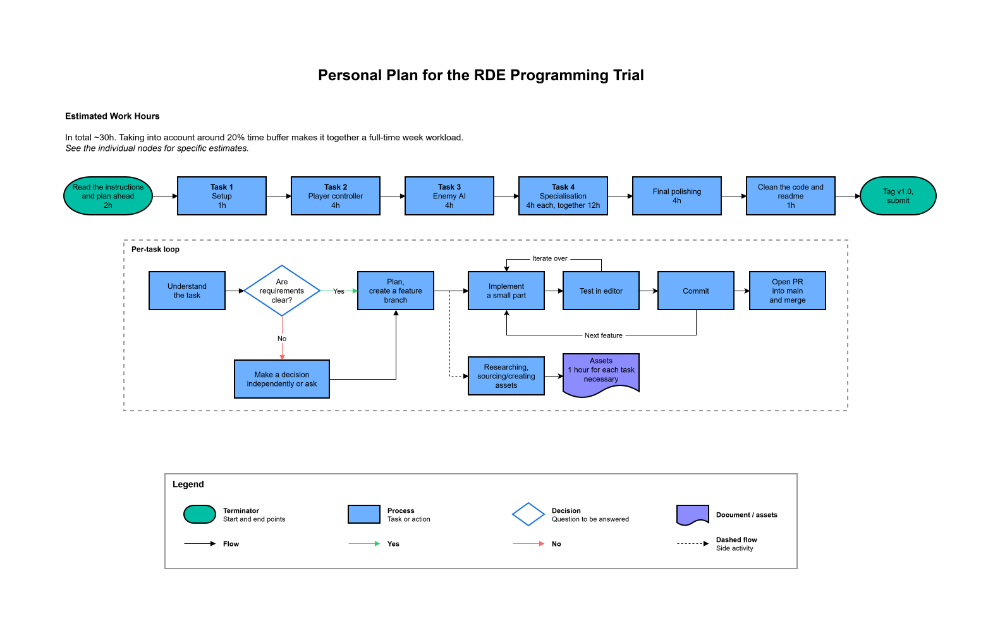

# Isometric 2D Game

This small game was developed in 5 days for a programming trial in an internship admission round.

- Task 1: Project setup and GitHub integration
- Task 2: Isometric player movement and input system
- Task 3: Enemy AI state machine
- Task 4: Specialization - Combat

## Overview

- **Engine:** Unity 6000.4.1f1 (2D URP)
- **Language:** C#
- **Platform:** PC

## Getting Started

### Requirements

- Unity 6000.4.1f1 (via Unity Hub)
- Git + Git LFS (`git lfs install`)

### Setup

1. Download or clone the repo: `git clone <url>`
2. Open the project folder in Unity Hub.
3. Open `Assets/_Project/Scenes/MainScene.unity`.
4. Press Play.

## Controls

| Action | Input      |
|--------|------------|
| Move   | WASD       |
| Attack | Left Click |
| Aim | Mouse Cursor |

## Design Decisions
- Reference Pixel per Unit is 32, which represents the basic tile size of 64x32 from the sprites I used. According to the author, 32x32 then in his scale roughly translates to the real world 1m2.
- Attacks convert cursor position to a snapped directional vector, which is one of 8 geo-directions going north, north-east, east,... These would align with the character animations, which were done for all 8 directions, although I haven't implemented them. 

## Features

See the implementation details of tasks 2,3 and 4 in the PRs, including how to test sections (some file/class names might be outdated).
PRs also have linked issues, which include checkboxes for the individual instruction points.

| Task        | PR                                                        |
|-------------|-----------------------------------------------------------|
| 2. Player Controller | [#3](https://github.com/Lonthre/isometric-2d-game/pull/3) |
| 3. Enemy AI | [#5](https://github.com/Lonthre/isometric-2d-game/pull/5) |
| 4. Combat   | [#8](https://github.com/Lonthre/isometric-2d-game/pull/8) |

## Known Bugs

- Enemies can get stuck at the water edges and do not follow the player when an obstacle is in-between, since navigation
  agents and obstacles were not implemented.
- The player can only hit enemies in roughly a half-circle above them and can't hit below the body. This should be
  explored by debugging the weapon hitbox collider with gizmos in-game.

## Reflection

Originally, I planned to spent on this around 37 hours as a whole week of full-time job. 
I noted my hours each day and ended up with 34 hours, so I did not use more time than I planned, but the scope of the project did get smaller. I have accounted for a delay in the estimation with the time buffer, and was also generous about doing all three specialisation - 4 hour each. This left me enough time allocated to finish all the mandatory points, even when I was behind with them.

The most notable differences between the planned estimation and
actual hours were following:

- Making of the diagram took me 1 hour more.
- Task 2 took ~9 hours (estimated 4, plus 1-2 hours for researching assets), which was too much. I got stuck mainly
  because I couldn't find any nice isometric 2D assets, and then I spent some time implementing animations, but in the
  end I scraped that because the spritesheets were not preprocessed at all and I was just losing time. What is left of
  that is an active player idle animation in one direction. I have prepared a helper table to lookup frame
  numbering [AnimationFrameLookup.md](Assets/Art/Characters/Player/AnimationFrameLookup.md). For the environment, I used tiles which were the quickest to setup up, but had in plan to replace them for nicer ones, either [grassland](https://opengameart.org/content/grassland-tileset) or [old ruins](https://opengameart.org/content/old-ruins-tileset). Cinemachine was also completely new to me, so I was learning along the way :)).
- Task 3 took ~10 hours, which is twice as much (estimated 4, plus 1 for assets). Since this task also now introduced
  coding, I spent most of the time here to make the scripts clean, scalable, and robust.
- Task 4 - Combat - took ~10 hours too, which is more than twice as much (I have hugely underestimated it will be 4
  hours per each specialisation!!). Making the combat was genuinely a challenge, I have done the basics and a hit flash.
  The scripts are generalised enough to be ready for adding ranged and automatic weapons as well, but I had no time for
  that in the end.

## AI Disclaimer

I have used Claude Sonnet 5.5 chatbot in a browser as an aid for purposes of refreshing C# syntax and Unity-specific
built-in functions, and as a debugging assistant. For example, I asked:

- How does IEnumerator work?
- What is the execution order of Awake, OnEnable, Start?
- I have this piece of code ... which throws this error ... and I can't find the solution to fix it, any suggestions how
  to debug it?

## Assets & Credits

See [CREDITS.md](Assets/Art/CREDITS.md).

## License

Code - MIT [LICENSE](LICENSE).

Third-party art is not covered by the MIT license. Each asset keeps its own license, listed
in [CREDITS.md](Assets/Art/CREDITS.md).